# Eventos Climáticos 2026
Foi revisado em sala de aula pelo professor Wellington (SENAI/SESI - Amparo) ``SQL``, ``JSON`` e ``JS`` de modo que seja criado um servidor funcional com usuários e sendo possível adicionar novos.
##### MER DER do projeto

##### Diagrama de Classes do projeto

## Tecnologias Utilizadas
* VS code
* mySQL
* Thunder Client

## Instruções para testar
1 Clone esse repositório  
2 Abra-o no [VS Code](https://code.visualstudio.com/download?_exp_download=d53503e735) 
3 Instale a extensão Thunder Client 
4 Clique em "New Request" 
5 Troque o link ao lado de GET por "http://localhost:3000/usuarios" 
6 Clique no GET e troque-o por POST 
7 Copie e cole, editando as informações:
``
{
  "nome": "macaco",
  "email": "makakin@email.com",
  "senha": "123"
}
``  
8 Clique em SEND, e seu Thunder Client deverá ficar assim: 
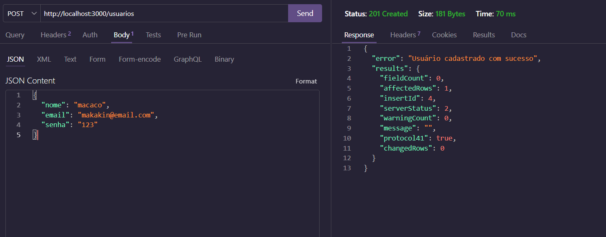

### Ao iniciar o servidor e ir em http://localhost:3000/usuarios o novo usuário aparecerá com os outros já cadastrados:
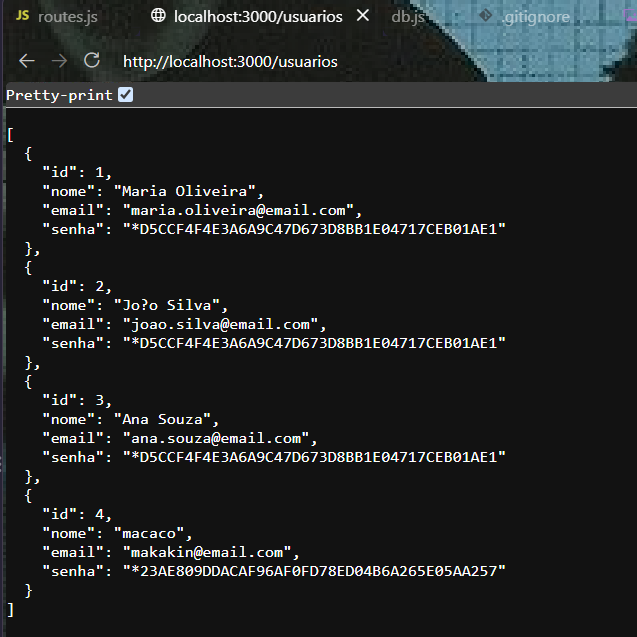

## Prints dos testes de cadastrar usuário

## Prints dos testes de cadastrar evento
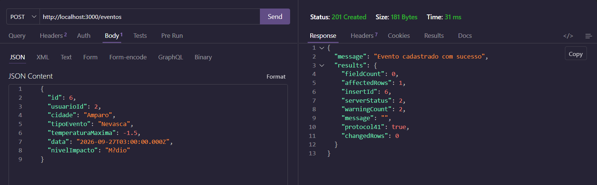
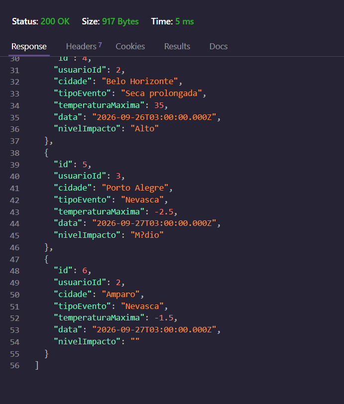

## Prints dos testes de listar
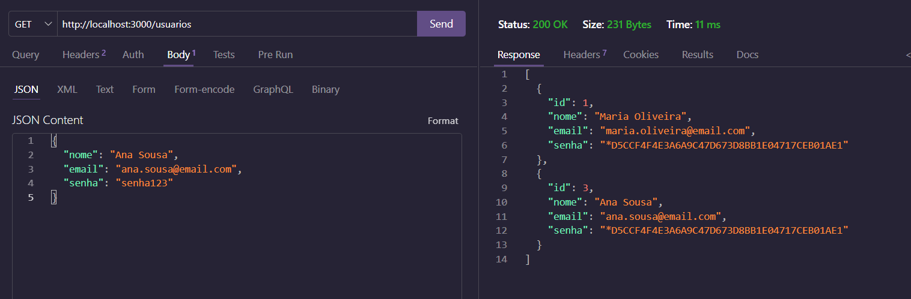

## Prints dos testes de atualizar usuário
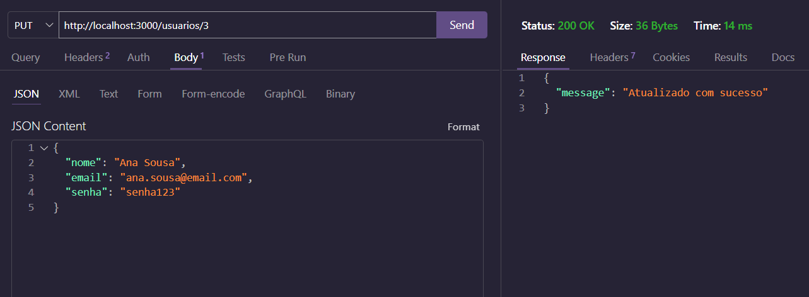

## Prints dos testes de atualizar evento
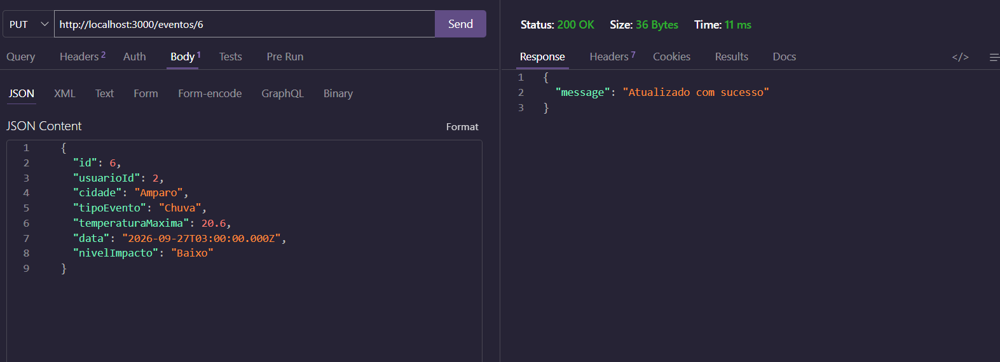
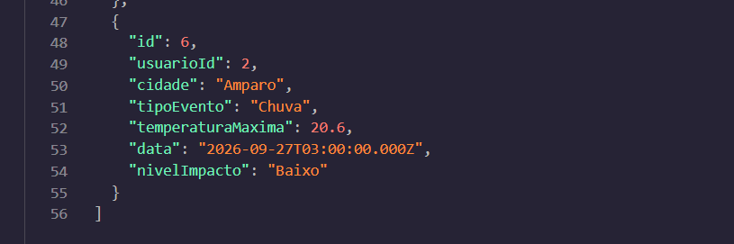

## Prints dos testes de excluir usuário
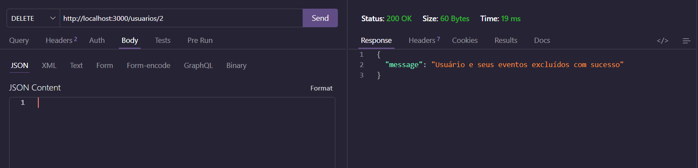
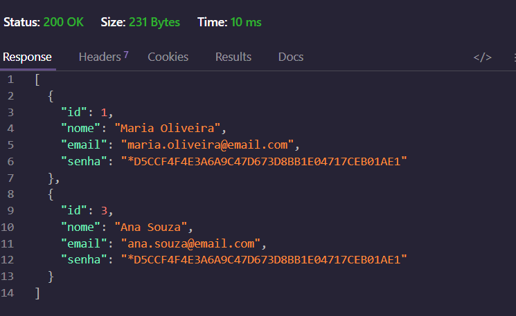

## Prints dos testes de excluir evento
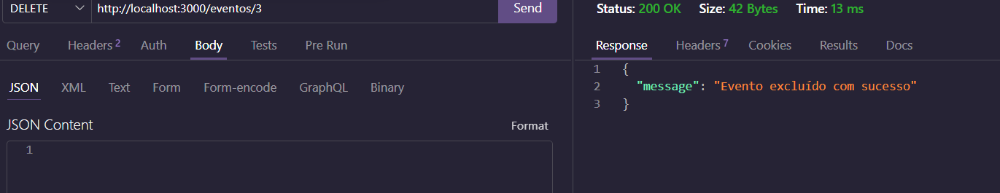
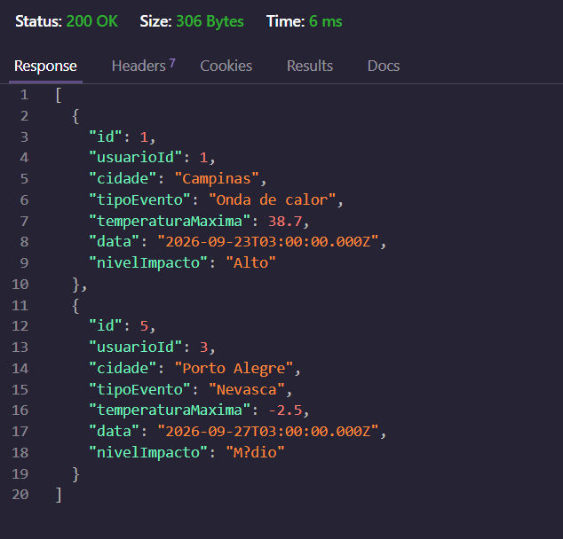

## Prints dos testes de resumo
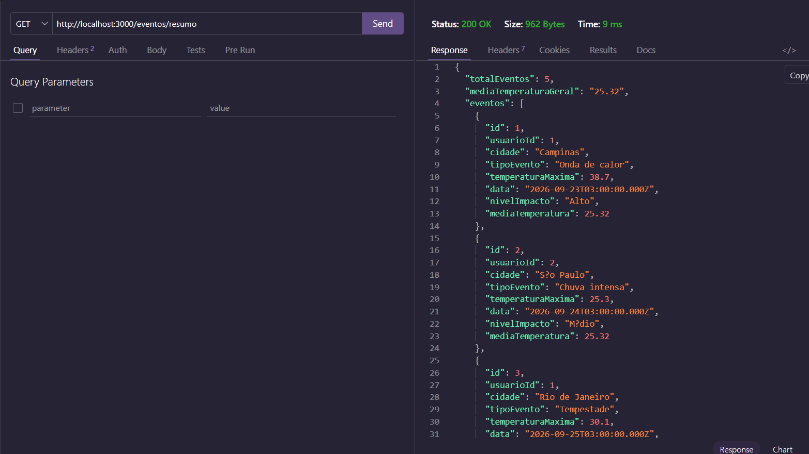

## Prints dos testes de login
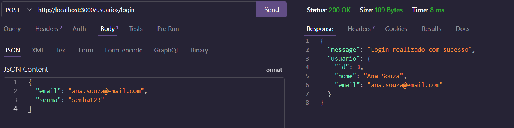